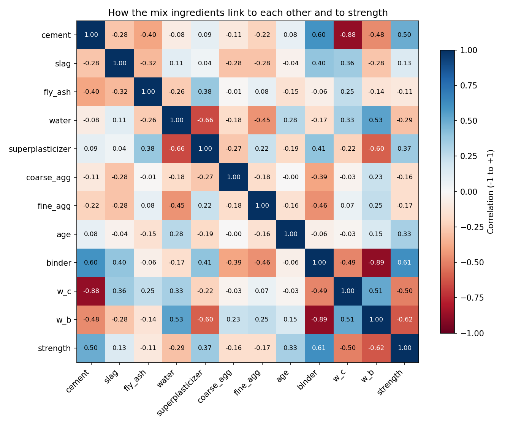
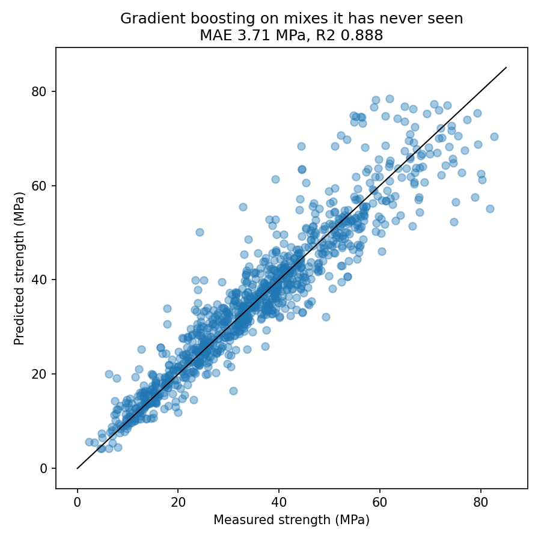
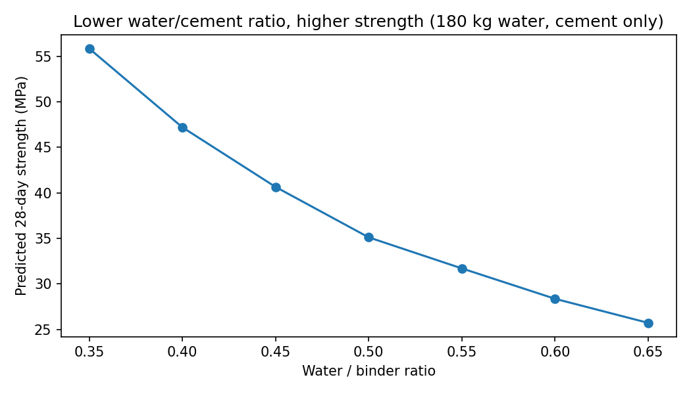
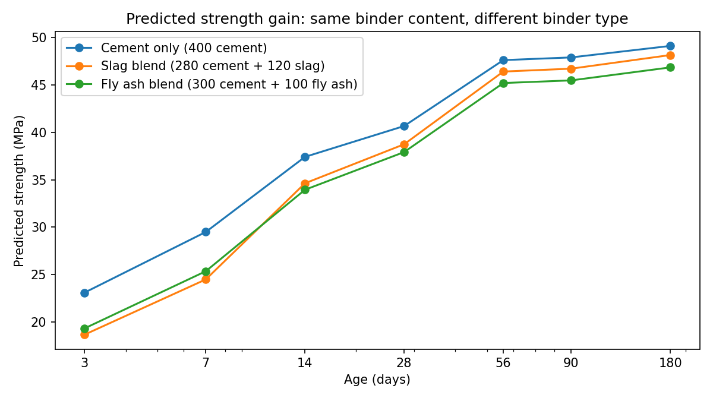

# Predicting Concrete Compressive Strength from the Mix Design

How strong will a concrete mix be at 7, 28 or 90 days? This project uses 1,002 laboratory results to predict compressive strength from the seven mix ingredients and the test age. It is tested in a way that matches the real question: **how strong will a mix be that we have never tested?**

| | |
|---|---|
| **Result** | Typical error **±3.5 MPa** on mixes the model has never seen (MAE 3.51 MPa, R² 0.90, average of 5 repeated tests) |
| **Model** | Gradient boosting (scikit-learn) with engineer's columns: water/cement, water/binder, binder content, slag and fly ash share |
| **Extra** | An interactive [Concrete Strength Estimator](ADD-LINK-HERE): enter a mix and an age, get the predicted strength and gain curve |
| **Tools** | Python, pandas, NumPy, scikit-learn, matplotlib |

I work as a materials technician on a road construction project, where I monitor concrete pours and handle cube results. This project connects that site work with data science.

---

## 1. The data

UCI *Concrete Compressive Strength* dataset (Prof. I-Cheng Yeh). Each row is one lab test:

- **Inputs:** cement, blast furnace slag, fly ash, water, superplasticizer, coarse aggregate, fine aggregate (all kg/m³) and age (1–365 days)
- **Target:** compressive strength (MPa)

The key finding from exploring it: the 1,030 rows contain only **428 different mixes**. Many mixes were crushed at several ages (3, 7, 28, 56 days and so on). That shapes how the model must be tested (section 4).

## 2. Cleaning

| Step | Rows |
|---|---|
| Original data | 1,030 |
| Removed 25 exact copies (identical to many decimals; real repeat cubes never match exactly) | 1,005 |
| Removed 3 suspect results where strength **dropped** more than 15% below an earlier age of the same mix (e.g. one mix: 35.3 MPa at 3 days, then 22.9 MPa at 7 days) | **1,002** |

Sanity check: total mass per m³ is 2,195–2,551 kg for every mix, which is realistic for concrete.

## 3. What the data shows

- **Water/binder ratio** (binder = cement + slag + fly ash) has the strongest link with strength: correlation −0.62 overall and **−0.77 at 28 days**. This is Abrams' law.
- **Superplasticizer and water** are strongly negatively linked (−0.66): mixes with more superplasticizer use less water.
- **Age** shows only 0.33, because strength rises fast and then levels off, and correlation only measures straight-line links.
- For mixes crushed at both ages, **7-day strength is typically 63% of 28-day strength** (range 27–98%).

## 4. Testing honestly

If rows are shuffled at random into training and checking sets, the same mix appears in both: the model sees a mix at 7 days and is then "tested" on that same mix at 28 days. That makes it look better than it is.

So I kept **all rows of a mix together** and tested only on mixes the model had never seen (grouped cross-validation).

| Model | MAE (MPa) | R² |
|---|---|---|
| Average guess (no learning) | 13.15 | 0.00 |
| Straight line, raw columns | 8.27 | 0.59 |
| Straight line, engineer's columns | 5.54 | 0.81 |
| Random forest, engineer's columns | 3.94 | 0.88 |
| Gradient boosting, raw columns | 4.02 | 0.88 |
| **Gradient boosting, engineer's columns** | **3.71** | **0.89** |

- The **engineer's columns** (w/c, w/b, binder, log of age, slag and fly ash share) improved every model. For the straight line they cut the error from 8.3 to 5.5 MPa.
- A **random test** makes the best model look like MAE 2.43 MPa and R² 0.95: the error looks **20–30% smaller** than it really is.
- With only 428 mixes, the honest score depends on which mixes land in which group (3.4 to 3.8 MPa across splits). So I repeated the test 5 times: **average MAE 3.51 MPa, R² 0.90.**

## 5. Practical findings

**Water/cement ratio** (predicted 28-day strength, 180 kg water, cement only):

| w/c | 0.35 | 0.40 | 0.45 | 0.50 | 0.55 | 0.60 | 0.65 |
|---|---|---|---|---|---|---|---|
| MPa | 56.8 | 47.0 | 41.4 | 34.8 | 31.1 | 28.1 | 24.5 |

**Binder type and early strength.** Same binder content (400 kg) and w/b 0.45:

| Mix | 7 days | 28 days | 7-day as share of 28-day |
|---|---|---|---|
| Cement only | 30.4 | 41.4 | 73% |
| 30% slag | 25.1 | 39.5 | 64% |
| 25% fly ash | 25.8 | 38.2 | 68% |

The real lab results agree: cement-only mixes reached a median **65%** of their 28-day strength at 7 days, slag mixes **57%**. A low 7-day cube on a slag or fly ash mix is not necessarily a failure; these mixes gain strength later.

**What the model relies on most:** water/binder ratio, then age, then water/cement ratio.

## 6. Limits

- The model only knows the mixes in this data: 102–540 kg cement, up to 359 kg slag, up to 200 kg fly ash, w/b 0.24–0.90, ages 1–365 days. Outside that range its estimate is a guess.
- It knows nothing about cement type or grade, aggregate type, curing conditions or admixtures other than superplasticizer.
- It is a planning and comparison tool. It does not replace cube or cylinder testing.

## 7. Files

| File | What it does |
|---|---|
| `concrete_day1_explore.py` | Explores the data: mixes, ages, correlations, 7-day vs 28-day |
| `concrete_day2_clean.py` | Removes copies and suspect results, adds engineer's columns, saves `clean_concrete.csv` |
| `concrete_day3_models.py` | Compares models with a random and an honest test, saves the model |
| `concrete_day4_insights.py` | Repeated honest test, effect of w/c, strength gain by binder type |

**To run:** put `Concrete_Data.xls` (from the UCI repository) in the same folder, `pip install pandas numpy scikit-learn matplotlib xlrd joblib`, then run the scripts in order.

## Data credit

I-Cheng Yeh, "Modeling of strength of high performance concrete using artificial neural networks," *Cement and Concrete Research*, Vol. 28, No. 12, pp. 1797–1808 (1998). Dataset from the UCI Machine Learning Repository.

## About me

I'm Sibahle Vathu, a materials technician in South Africa building practical data science skills through real projects.

<!-- Add your GitHub, LinkedIn and email here -->
